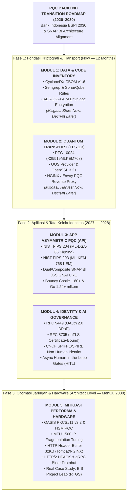
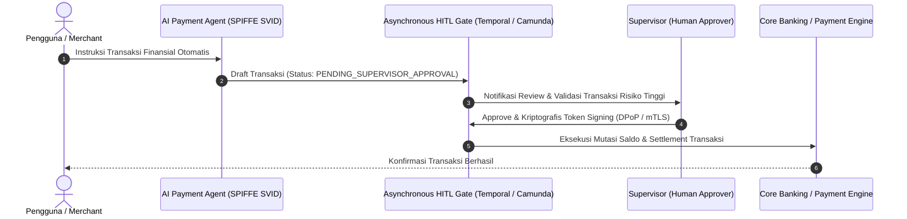

# Roadmap Belajar Terapan: Applied Post-Quantum Cryptography (PQC) untuk Backend Engineer

> **Fokus Arsitektur:** Arsitektur Keamanan Backend, API Gateway, Standar Nasional Open API Pembayaran (**SNAP BI**), Infrastruktur Switching / Fast Payment, dan Visi Regulasi **BSPI 2030 (Bank Indonesia)**.  
> **Dokumen Referensi Resmi:** [`references/Blueprint-Sistem-Pembayaran-Indonesia-2030_2.pdf`](./references/Blueprint-Sistem-Pembayaran-Indonesia-2030_2.pdf) | Ringkasan BSPI: [`references/bspi-2030-executive-summary.md`](./references/bspi-2030-executive-summary.md) | Panduan Teknis NIST SP 1800-38: [`docs/guides/panduan-migrasi-pqc-nist-sp-1800-38.md`](./docs/guides/panduan-migrasi-pqc-nist-sp-1800-38.md)

---

Berikut adalah **Kurasi Sumber Belajar Terlengkap & Terapan (Evidence-Based Curriculum)** yang disusun khusus untuk *Backend Developer / Software Architect* guna menguasai seluruh modul pada *blueprint* Post-Quantum Cryptography (PQC), berorientasi pada standar **SNAP BI** dan visi regulasi **BSPI 2030 (Bank Indonesia)**.

Katalog ini mencakup standar resmi (NIST FIPS, IETF RFC), repositori *open-source*, *sandbox* laboratorium Docker, buku referensi industri, studi kasus bank sentral dunia (BIS Project Leap), hingga *code snippet* siap pakai.

---

## 🗺️ Visual Architecture & Transition Roadmap (2026–2030)



<details>
<summary><b>Klik di sini untuk melihat Diagram ASCII Asli</b></summary>

```text
                                      +---------------------------------------------+
                                      |         ROADMAP PQC BACKEND 2026-2030       |
                                      +---------------------------------------------+
                                                             |
              +----------------------------------------------+----------------------------------------------+
              |                                              |                                              |
     [Now - 12 Months]                              [Now - 12 Months]                                 [2027 - 2028]
  DATA & CODE INVENTORY                            QUANTUM TRANSPORT (TLS)                       APP ASYMMETRIC PQC (API)
+-------------------------+                     +---------------------------+                 +----------------------------+
| * CycloneDX CBOM v1.6   |                     | * RFC 10024 (X25519MLKEM) |                 | * FIPS 204 (ML-DSA / Sign) |
| * Semgrep & SonarQube   |                     | * OQS Provider (OpenSSL)  |                 | * FIPS 203 (ML-KEM / KEM)  |
| * AES-256-GCM Envelope  |                     | * NGINX / Envoy PQC Proxy |                 | * SNAP BI Hybrid Signature |
+-------------------------+                     +---------------------------+                 +----------------------------+
              |                                              |                                              |
              +----------------------------------------------+----------------------------------------------+
                                                             |
              +----------------------------------------------+----------------------------------------------+
              |                                                                                             |
        [Now - 2028]                                                                                   [Architect Level]
  IDENTITY & AI GOVERNANCE                                                                       PERFORMANCE & HARDWARE
+------------------------------------+                                                        +-----------------------------------+
| * RFC 9449 (DPoP Proof-of-Possess) |                                                        | * PKCS#11 v3.2 & wolfPKCS11       |
| * RFC 8705 (mTLS Token Binding)    |                                                        | * MTU Fragmentation & Buffer Tune |
| * SPIFFE/SPIRE for AI Agents       |                                                        | * HTTP/2 HPACK & gRPC Biner       |
| * Async Human-in-the-Loop Gate     |                                                        | * Real Case: BIS Project Leap     |
+------------------------------------+                                                        +-----------------------------------+
```

</details>

---

## MODUL 1: Kriptografi Data & Inventarisasi Kode (*Target: Now — Next 12 Months*)
> **Tujuan:** Mengetahui posisi kerentanan kriptografi di seluruh repositori (*Cryptographic Visibility*) dan mengamankan *data at rest* dari serangan **Store Now, Decrypt Later (SNDL)**.

### 1. Standar Resmi & Framework Kepatuhan
* **NIST SP 1800-38 (Volume A, B, C): *Migration to Post-Quantum Cryptography***
  * *Penerbit:* NIST National Cybersecurity Center of Excellence (NCCoE).
  * *Fokus:* Volume B memberikan cetak biru arsitektur enterprise untuk *Cryptographic Discovery*, otomatisasi audit dependensi, dan integrasi CBOM ke siklus CI/CD.
  * [NIST NCCoE SP 1800-38 Project](https://www.nist.gov/programs-projects/migration-post-quantum-cryptography)
  * *File PDF Resmi (Google Drive):*
    * [Post Quantum Cryptography - Google Drive](https://drive.google.com/drive/u/0/folders/1cYg1miKm8vfst9E355slB-pz1Hgd1mEs) (Memuat berkas PDF lengkap NIST SP 1800-38 Volume A, Volume B, dan Volume C)
  * *Panduan Teknis Terpadu (Bahasa Indonesia):*
    * [`docs/guides/panduan-migrasi-pqc-nist-sp-1800-38.md`](./docs/guides/panduan-migrasi-pqc-nist-sp-1800-38.md) (Sintesis teknis Volume A, B, dan C: Teorema Mosca, CBOM, format sertifikat X.509 hibrida, dan dilema digest-then-sign HSM)
* **Spesifikasi CycloneDX v1.6 (Cryptographic Assets / CBOM):**
  * *Fokus:* Skema standar industri untuk mendokumentasikan aset kriptografi: algoritma, panjang kunci, mode operasi cipher, fungsi padding, level keamanan (NIST Category 1–5), dan sertifikat digital.
  * [CycloneDX 1.6 Cryptographic Properties Specification](https://cyclonedx.org/docs/1.6/)
* **PCI DSS v4.0 Requirement 12.3.3 (Mandat Inventaris Kriptografi):**
  * *Fokus:* Standar wajib kepatuhan industri kartu pembayaran dan perbankan untuk mendokumentasikan siklus hidup seluruh cipher suites dan algoritma.

### 2. Tooling Hands-On & Repositori Open-Source
* **OWASP `cdxgen` (CLI Generator CBOM):**
  * Tool otomatis untuk memindai proyek Java (Maven/Gradle), Go, Node.js, atau Python guna menghasilkan file CBOM CycloneDX v1.6.
  * [GitHub: CycloneDX/cdxgen](https://github.com/CycloneDX/cdxgen)
  * *Contoh Perintah Eksekusi:*
    ```bash
    npm install -g @cdxgen/cdxgen
    # Pindai project Java / Go dan hasilkan spesifikasi CBOM
    cdxgen -t java --include-crypto --spec-version 1.6 -o cbom.json .
    ```
* **Linux Foundation PQCA - CBOMkit (`cbomkit-hyperion` & `cbomkit-theia`):**
  * Tool analisis statis kode untuk mengekstrak jejak algoritma kriptografi langsung dari pustaka pihak ketiga.
  * [GitHub: PQCA / cbomkit](https://github.com/PQCA)
* **Semgrep Registry - Custom Cryptography Audit Rules:**
  * Kumpulan aturan static analysis untuk mendeteksi instansiasi algoritma legacy seperti `MD5`, `SHA-1`, `DES`, `3DES`, atau `RSA` dengan panjang kunci `< 2048`.
  * [Semgrep Registry Cryptography Rules](https://semgrep.dev/explore)

### 3. Buku & Arsitektur Enkripsi Simetris (Data at Rest)
* **Buku: *Real-World Cryptography* oleh David Wong (Manning Publications):**
  * *Wajib Baca:* Bab 4 (*Authenticated Encryption / AES-GCM*) dan Bab 12 (*Post-Quantum Cryptography*). Buku ini menjelaskan secara matematis mengapa AES-256 tahan terhadap Algoritma Grover (keamanan efektif turun menjadi 128-bit, yang masih mustahil di-brute force).
* **AWS KMS Cryptographic Details Whitepaper:**
  * Penjelasan teknis mengenai pola arsitektur **Envelope Encryption** (memisahkan *Data Encryption Key* / DEK dari *Key Encryption Key* / KEK) untuk membatasi risiko kebocoran master key.
  * [AWS KMS Envelope Encryption Concepts](https://docs.aws.amazon.com/kms/latest/developerguide/concepts.html#enveloping)
* **HashiCorp Vault - Transit Secrets Engine:**
  * Implementasi *Cryptography-as-a-Service* (CaaS) untuk rotasi DEK terpusat dan klasifikasi data perbankan berdasarkan *shelf-life* (masa retensi kerahasiaan).
  * [HashiCorp Vault Transit Engine Tutorial](https://developer.hashicorp.com/vault/docs/secrets/transit)

---

## MODUL 2: Transport Layer Tahan Kuantum (*Target: Now — Next 12 Months*)
> **Tujuan:** Melindungi trafik jaringan API Gateway / Reverse Proxy dari intersepsi data jaringan dan serangan **Harvest Now, Decrypt Later (HNDL)**.

### 1. Standar & Spesifikasi Protokol Resmi
* **RFC 10024: *Post-Quantum Traditional (PQ/T) Hybrid Key Agreement in TLS 1.3***
  * *Status:* Standar resmi IETF (Standards Track), menetapkan kombinasi kurva eliptik klasik dengan ML-KEM.
  * *Codepoints Resmi IANA:*
    * `0x11EC` → **`X25519MLKEM768`** (Profil rekomendasi industri untuk external public endpoint).
    * `0x11ED` → **`SecP256r1MLKEM768`**
    * `0x11EE` → **`SecP384r1MLKEM1024`**
  * [IETF RFC 10024](https://datatracker.ietf.org/doc/rfc10024/)

### 2. Repositori Praktik & Lab Sandbox
* **Open Quantum Safe (OQS) Project (Linux Foundation):**
  * Pustaka inti C (`liboqs`) dan provider OpenSSL 3.2+ (`oqs-provider`).
  * [GitHub: open-quantum-safe/liboqs](https://github.com/open-quantum-safe/liboqs) & [oqs-provider](https://github.com/open-quantum-safe/oqs-provider)
  * *Lab Praktik Cepat dengan Docker:*
    ```bash
    # 1. Jalankan NGINX Reverse Proxy dengan kemampuan PQC TLS 1.3
    docker run --name oqs-nginx -p 4433:4433 -d openquantumsafe/nginx

    # 2. Uji coba Client Handshake menggunakan curl PQC
    docker run --rm -it openquantumsafe/curl curl -k -v --tlsv1.3 \
      --curves x25519_mlkem768 https://host.docker.internal:4433
    ```
* **Cloudflare Post-Quantum Cryptography Engineering Blog:**
  * Dokumentasi dan data telemetri produksi terbesar di dunia mengenai performa dan implementasi `X25519MLKEM768` di edge server.
  * [Cloudflare Post-Quantum Blog Series](https://blog.cloudflare.com/tag/post-quantum/)
* **Wireshark 4.4+:**
  * Gunakan Wireshark versi terbaru untuk menginspeksi paket `ClientHello` TLS 1.3: periksa field `supported_groups` dan `key_share` untuk memvalidasi codepoint `0x11EC`.

---

## MODUL 3: Algoritma Asimetris PQC di Level Aplikasi (*Target: 2027–2028*)
> **Tujuan:** Menguasai algoritma pengganti `RSA-2048` pada header `X-SIGNATURE` SNAP BI dan mekanisme pertukaran kunci antar-*microservice*.

### 1. Standar Resmi NIST FIPS (Dirilis 13 Agustus 2024)
* **FIPS 203:** *Module-Lattice-Based Key-Encapsulation Mechanism Standard (ML-KEM)* — turunan CRYSTALS-Kyber.
  * [NIST FIPS 203 Final Publication](https://csrc.nist.gov/pubs/fips/203/final)
* **FIPS 204:** *Module-Lattice-Based Digital Signature Standard (ML-DSA)* — turunan CRYSTALS-Dilithium.
  * [NIST FIPS 204 Final Publication](https://csrc.nist.gov/pubs/fips/204/final)
* **FIPS 205:** *Stateless Hash-Based Digital Signature Standard (SLH-DSA)* — turunan SPHINCS+.
  * [NIST FIPS 205 Final Publication](https://csrc.nist.gov/pubs/fips/205/final)

### 2. Ekosistem Java & Spring Boot
* **Bouncy Castle JCA/JCE Provider (`bcprov-jdk18on` v1.80+):**
  * Pustaka kriptografi Java untuk FIPS 204 (`ML-DSA-44`, `ML-DSA-65`, `ML-DSA-87`) dan FIPS 203 (`ML-KEM-512`, `ML-KEM-768`, `ML-KEM-1024`).
  * [Bouncy Castle Java GitHub](https://github.com/bcgit/bc-java)
* **Roadmap JDK Resmi (JEP):**
  * **JEP 452 (Java 21 LTS):** Abstraksi framework API `javax.crypto.KEM`.
  * **JEP 496 (Java 24+):** Dukungan native ML-KEM di JDK.
  * **JEP 497 (Java 24+):** Dukungan native ML-DSA di JDK.
  *(Catatan Arsitektur: Pada Java 21, developer wajib mendaftarkan provider Bouncy Castle v1.80+ secara eksplisit).*

#### Contoh Implementasi Java: Signing Header SNAP BI dengan ML-DSA-65
```java
package com.bank.snap.crypto;

import org.bouncycastle.jce.provider.BouncyCastleProvider;
import java.nio.charset.StandardCharsets;
import java.security.*;
import java.util.Base64;

public class SnapPqcSigner {
    static {
        if (Security.getProvider("BC") == null) {
            Security.addProvider(new BouncyCastleProvider());
        }
    }

    public static void main(String[] args) throws Exception {
        // 1. Generate KeyPair ML-DSA-65 (NIST Security Category 3)
        KeyPairGenerator kpg = KeyPairGenerator.getInstance("ML-DSA-65", "BC");
        KeyPair keyPair = kpg.generateKeyPair();

        // 2. Format stringToSign sesuai Standar Teknis SNAP BI B2B Token
        String clientKey = "MERCHANT-CORP-ID-00129";
        String xTimestamp = "2026-10-29T14:30:00+07:00";
        String stringToSign = clientKey + "|" + xTimestamp;

        // 3. Signing menggunakan ML-DSA-65 (FIPS 204)
        Signature signer = Signature.getInstance("ML-DSA-65", "BC");
        signer.initSign(keyPair.getPrivate());
        signer.update(stringToSign.getBytes(StandardCharsets.UTF_8));
        byte[] signatureBytes = signer.sign();

        String xSignature = Base64.getEncoder().encodeToString(signatureBytes);
        System.out.println("ML-DSA-65 Raw Signature Size: " + signatureBytes.length + " bytes"); // 3.309 bytes
        System.out.println("X-SIGNATURE Base64 Length: " + xSignature.length() + " chars");       // ~4.412 chars

        // 4. Verifikasi Signature di sisi API Gateway Bank
        Signature verifier = Signature.getInstance("ML-DSA-65", "BC");
        verifier.initVerify(keyPair.getPublic());
        verifier.update(stringToSign.getBytes(StandardCharsets.UTF_8));
        boolean isValid = verifier.verify(signatureBytes);

        System.out.println("SNAP BI Signature Verified: " + isValid);
    }
}
```

### 3. Ekosistem Go (Golang)
* **Standard Library Go 1.24+: `crypto/mlkem`:**
  * Implementasi native FIPS 203 ML-KEM-768 dan ML-KEM-1024 tanpa third-party dependency.
  * [Go Documentation: pkg.go.dev/crypto/mlkem](https://pkg.go.dev/crypto/mlkem)
* **Cloudflare CIRCL (`circl/sign/mldsa`):**
  * Pustaka Go untuk implementasi penandatanganan digital FIPS 204 ML-DSA.
  * [GitHub: cloudflare/circl](https://github.com/cloudflare/circl)

### 4. Tanda Tangan Komposit / Hybrid & Standar SNAP BI
* **IETF Draft: `draft-ietf-lamps-pq-composite-sigs`:**
  * *Judul:* *Composite Module-Lattice-Based Digital Signature Algorithm for use in X.509 PKI*.
  * *Arsitektur:* Menggabungkan signature klasik (`RSA` atau `ECDSA`) dengan `ML-DSA` secara atomik. Verifikasi berhasil jika dan hanya jika kedua signature valid.
  * [IETF draft-ietf-lamps-pq-composite-sigs](https://datatracker.ietf.org/doc/draft-ietf-lamps-pq-composite-sigs/)
* **Pedoman Resmi SNAP BI (Bank Indonesia & ASPI):**
  * Dokumentasi resmi spesifikasi teknis SNAP B2B Token Asymmetric Signature & Transactional Symmetric Signature.
  * [Portal Standar Nasional Open API Pembayaran (SNAP) BI](https://www.bi.go.id/id/fungsi-utama/sistem-pembayaran/standar/snap/default.aspx)

---

## MODUL 4: Manajemen Identitas Modern: Token & AI Agent (*Target: Now s/d 2028*)
> **Tujuan:** Mencegah pencurian token API perbankan via mekanisme *Proof-of-Possession* dan membangun tata kelola identitas kriptografis otonom untuk AI Agent.

### 1. Device-Bound Tokens (Anti-Theft API Tokens)
* **RFC 9449: *OAuth 2.0 Demonstrating Proof-of-Possession (DPoP)***
  * *Konsep:* Mencegah penyalahgunaan bearer token yang dicuri. Klien membuktikan kepemilikan private key dengan menyertakan header `DPoP` (JWT bertanda tangan) pada setiap panggilan API. Token diikat ke sidik jari kunci publik klien (`cnf.jkt`).
  * [IETF RFC 9449](https://datatracker.ietf.org/doc/html/rfc9449)
* **RFC 8705: *OAuth 2.0 Mutual-TLS Client Authentication and Certificate-Bound Access Tokens***
  * *Konsep:* Token diikat langsung ke sertifikat X.509 pada sesi mTLS klien (*sender-constrained tokens*).
  * [IETF RFC 8705](https://datatracker.ietf.org/doc/html/rfc8705)
* **Spring Security OAuth 2.0 DPoP Reference:**
  * Dukungan DPoP otomatis tersedia pada Spring Security 6.5–7.0, dan konfigurasi DSL eksplisit `.dPoP(Customizer.withDefaults())` tersedia di Spring Security 7.1+.
  * [Spring Security DPoP Documentation](https://docs.spring.io/spring-security/reference/servlet/oauth2/resource-server/dpop.html)

### 2. Tata Kelola Identitas AI Agent (Non-Human Identity & Delegation)
* **CNCF SPIFFE / SPIRE:**
  * Standar industri untuk memberikan identitas kriptografis (*SPIFFE ID* & *SVID*) berbasis X.509/JWT kepada container, service, atau AI Agent runtime.
  * [SPIFFE / SPIRE Official Concepts](https://spiffe.io/docs/latest/spiffe-about/spiffe-concepts/)
* **IETF WIMSE (Workload Identity in Multi-System Environments) Working Group:**
  * Standarisasi bridging antara SPIFFE workload identity dengan OAuth 2.0 token exchange untuk sistem terdistribusi multi-domain.
  * [IETF WIMSE Working Group](https://datatracker.ietf.org/wg/wimse/about/)
* **RFC 8693: *OAuth 2.0 Token Exchange***
  * Spesifikasi pertukaran token dengan dukungan *Actor Claim* (`act`), mendokumentasikan jejak audit rantai delegasi (`User` → `Orchestrator Agent` → `Payment Execution Agent`).
  * [IETF RFC 8693](https://datatracker.ietf.org/doc/html/rfc8693)
* **Human-in-the-Loop (HITL) Asynchronous Approval Gates:**
  * *Framework:* **Temporal.io** atau **Camunda 8 (BPMN User Tasks)**.
  * *Pola Arsitektur:* Agen AI membuat draft transaksi finansial → transaksi masuk status `PENDING_SUPERVISOR_APPROVAL` → manusia memverifikasi dan menandatangani kriptografis token persetujuan → workflow melanjutkan mutasi saldo.
  * [Temporal.io Human-in-the-Loop Architecture Guide](https://temporal.io/)



---

## MODUL 5: Mitigasi Performa & Integrasi Hardware (*Level Arsitek*)
> **Tujuan:** Mengamankan private key ke modul HSM dan merekayasa infrastruktur jaringan agar tidak kolaps akibat pembengkakan payload PQC.

### 1. Hardware Security Module (HSM) & PKCS#11 PQC
* **Spesifikasi OASIS PKCS#11 v3.2 (PQC Extension Mechanisms):**
  * Standar industri untuk mekanisme kriptografi hardware PQC: `CKM_ML_DSA`, `CKM_ML_KEM`, `CKM_SLH_DSA`.
  * [OASIS PKCS#11 Committee Specifications](https://www.oasis-open.org/committees/pkcs11/)
* **wolfPKCS11 & SoftHSM Open-Source Integrations:**
  * Pustaka ringan untuk simulasi token kriptografi PKCS#11 yang telah mendukung algoritma post-quantum.
  * [GitHub: wolfSSL/wolfPKCS11](https://github.com/wolfSSL/wolfPKCS11)
  * [Oracle Java PKCS#11 Reference Guide](https://docs.oracle.com/en/java/javase/21/security/pkcs11-reference-guide1.html)

### 2. Pembengkakan Payload & Fragmentasi Jaringan (MTU Mitigation)
* **Perbandingan Ukuran Kriptografis (Matematika Payload):**
  * `RSA-2048`: Public Key = **256 bytes**, Signature = **256 bytes** (Base64 di header HTTP $\approx$ **344 karakter**).
  * `ML-DSA-65`: Public Key = **1.952 bytes**, Signature = **3.309 bytes** (Base64 di header HTTP $\approx$ **4.412 karakter**).
  * `Composite (Dual Signing RSA + ML-DSA)`: Signature membengkak menjadi **>3.565 bytes** (Base64 $\approx$ **4.760 karakter**).
* **Masalah Fragmentasi TCP/IP Layer:**
  * Batas *Maximum Transmission Unit* (MTU) Ethernet standar adalah **1500 bytes**. Tanda tangan ML-DSA-65 di header HTTP dipastikan terpecah minimal menjadi **3 fragmen paket IP**. Jika terjadi *packet loss*, latensi transmisi melonjak drastis.
* **Tuning Buffer Web Server & API Gateway:**
  * **Spring Boot (Tomcat / Netty):** Default header buffer Tomcat adalah 8 KB (8192 bytes). Header gabungan SNAP (`X-SIGNATURE` + cert chain + DPoP + tracing headers) dapat memicu error `431 Request Header Fields Too Large`.
    ```yaml
    # application.yml
    server:
      max-http-request-header-size: 32KB
    ```
  * **NGINX API Gateway / Reverse Proxy:**
    ```nginx
    # nginx.conf
    client_header_buffer_size 4k;
    large_client_header_buffers 4 32k;
    ```
* **Solusi Lanjutan: HTTP/2 HPACK & Migrasi ke gRPC:**
  * **HTTP/2 (RFC 7541 HPACK) & HTTP/3 (QPACK):** Mengompresi overhead header HTTP berulang antar-request pembayaran finansial.
  * **gRPC / Protocol Buffers:** Memindahkan signature dari teks Base64 (yang menambah beban 33% overhead) ke dalam payload field biner protobuf (`bytes`).

---

## Studi Kasus Perbankan Nyata: BIS Innovation Hub - Project Leap
* **Laporan Resmi Bank for International Settlements (BIS) bersama Banque de France & Deutsche Bundesbank:**
  * Eksperimen nyata migrasi PQC pada sistem pembayaran antar-bank **Real-Time Gross Settlement (RTGS / TARGET2)**.
  * *Insight Kunci:* Hambatan terbesar adopsi PQC di perbankan bukan pada komputasi CPU, melainkan **pembengkakan ukuran paket (10x)** yang memicu *buffer overflow* pada konektor pembayaran warisan (ESMIG / SWIFT) dan fragmentasi paket jaringan.
  * [BIS Project Leap Phase 2 Report: PQC in Payment Systems](https://www.bis.org/publ/othp86.htm)

---

## 📅 Panduan Eksekusi Portofolio 7 Hari: "SNAP BI Hybrid PQC Payment Gateway"

Berikut panduan langkah demi langkah untuk mengimplementasikan proyek portofolio dalam 1 minggu:

| Hari | Tahapan & Fokus | Komponen & Hands-On Deliverables |
| :--- | :--- | :--- |
| **Hari 1–2** | **Cryptographic Benchmark Lab** | • Setup Java 21+ / Spring Boot dengan Bouncy Castle 1.80+ (`bcprov-jdk18on`)<br/>• Implementasikan JMH (Java Microbenchmark Harness) untuk mengukur latensi CPU & alokasi memori: `RSA-2048` vs `ML-DSA-44` vs `ML-DSA-65` vs `ML-DSA-87`<br/>• Buat grafik komparasi: throughput (ops/sec), byte signature, dan Base64 header length |
| **Hari 3–4** | **Crypto-Agile Provider Pattern** *(SNAP BI Header Integration)* | • Rancang arsitektur Strategy Pattern dengan interface `SnapSignatureEngine`:<br/>&nbsp;&nbsp;– `RsaSignatureEngine` (Legacy SHA256withRSA standar SNAP BI saat ini)<br/>&nbsp;&nbsp;– `MlDsaSignatureEngine` (PQC FIPS 204)<br/>&nbsp;&nbsp;– `HybridCompositeSignatureEngine` (Dual signing: RSA + ML-DSA)<br/>• Konfigurasikan engine via Spring `@ConditionalOnProperty` / Environment Variable<br/>• Format `stringToSign` sesuai aturan ASPI: `stringToSign = X-CLIENT-KEY + "\|" + X-TIMESTAMP` |
| **Hari 5–6** | **Gateway Buffer Tuning, DPoP, & Network Testing** | • Tempatkan NGINX reverse proxy di depan backend Spring Boot<br/>• Konfigurasikan buffer header (32KB) dan simulasi stress-test pengiriman header PQC<br/>• Implementasikan proteksi OAuth 2.0 DPoP (RFC 9449) pada endpoint `/v1.0/access-token/b2b`<br/>• Uji coba untuk memastikan tidak terjadi error HTTP 431 atau TCP timeout |
| **Hari 7** | **Integrasi Resilient Engine & Dokumentasi GitHub** | • Hubungkan modul verifikasi hybrid ini ke orchestrator pembayaran BI-FAST<br/>• Buat skenario failover: jika BI-FAST down, alihkan transaksi otomatis ke Jaringan Switching / Fast Payment Industri (bukan BI-RTGS)<br/>• Publikasikan kode ke GitHub dengan diagram arsitektur enterprise, penjelasan mitigasi MTU, serta referensi ke roadmap BSPI 2030 Bank Indonesia |

<details>
<summary><b>Klik di sini untuk melihat Tabel Format ASCII Asli</b></summary>

```text
+---------------------------------------------------------------------------------------------------+
| JADWAL EKSEKUSI PORTOFOLIO 7 HARI: "SNAP BI HYBRID PQC PAYMENT GATEWAY"                           |
+---------------------------------------------------------------------------------------------------+
| HARI 1-2: Cryptographic Benchmark Lab                                                             |
| * Setup Java 21+ / Spring Boot dengan Bouncy Castle 1.80+ (bcprov-jdk18on).                       |
| * Implementasikan JMH (Java Microbenchmark Harness) untuk mengukur latensi CPU & alokasi memori:   |
|   RSA-2048 vs ML-DSA-44 vs ML-DSA-65 vs ML-DSA-87.                                              |
| * Buat grafik komparasi: throughput (ops/sec), byte signature, dan Base64 header length.          |
+---------------------------------------------------------------------------------------------------+
| HARI 3-4: Crypto-Agile Provider Pattern (SNAP BI Header Integration)                              |
| * Rancang arsitektur Strategy Pattern dengan interface `SnapSignatureEngine`:                     |
|   - `RsaSignatureEngine` (Legacy SHA256withRSA standar SNAP BI saat ini).                         |
|   - `MlDsaSignatureEngine` (PQC FIPS 204).                                                        |
|   - `HybridCompositeSignatureEngine` (Dual signing: RSA + ML-DSA).                                |
| * Konfigurasikan engine via Spring `@ConditionalOnProperty` / Environment Variable.              |
| * Format stringToSign sesuai aturan ASPI: stringToSign = X-CLIENT-KEY + "|" + X-TIMESTAMP.        |
+---------------------------------------------------------------------------------------------------+
| HARI 5-6: Gateway Buffer Tuning, DPoP, & Network Testing                                          |
| * Tempatkan NGINX reverse proxy di depan backend Spring Boot.                                     |
| * Konfigurasikan buffer header (32KB) dan simulasi stress-test pengiriman header PQC.             |
| * Implementasikan proteksi OAuth 2.0 DPoP (RFC 9449) pada endpoint `/v1.0/access-token/b2b`.      |
| * Uji coba untuk memastikan tidak terjadi error HTTP 431 atau TCP timeout.                        |
+---------------------------------------------------------------------------------------------------+
| HARI 7: Integrasi Resilient Engine (SAGA & Outbox Pattern) & Dokumentasi GitHub                   |
| * Hubungkan modul verifikasi hybrid ini ke orchestrator pembayaran BI-FAST.                      |
| * Buat skenario failover: jika BI-FAST down, alihkan transaksi otomatis ke Jaringan Switching /    |
|   Fast Payment Industri (bukan BI-RTGS).                                                          |
| * Publikasikan kode ke GitHub dengan diagram arsitektur enterprise, penjelasan mitigasi MTU,      |
|   serta referensi ke roadmap BSPI 2030 Bank Indonesia.                                            |
+---------------------------------------------------------------------------------------------------+
```

</details>

---

## 🏛️ Dokumen Sumber Kebijakan & Referensi Resmi

Dokumen resmi standar dan cetak biru kebijakan disertakan di dalam repository ini:

### 1. Bank Indonesia — Sistem Pembayaran
* **File Resmi (PDF):** [`references/Blueprint-Sistem-Pembayaran-Indonesia-2030_2.pdf`](./references/Blueprint-Sistem-Pembayaran-Indonesia-2030_2.pdf) (26 MB, 52 Halaman)
* **Eksekutif Ringkasan Teknis:** [`references/bspi-2030-executive-summary.md`](./references/bspi-2030-executive-summary.md)

### 2. NIST National Cybersecurity Center of Excellence (NCCoE) — SP 1800-38 Suite
* **Volume A (Executive Summary):** [`references/pqc-migration-nist-sp-1800-38a-preliminary-draft.pdf`](./references/pqc-migration-nist-sp-1800-38a-preliminary-draft.pdf) — Ringkasan eksekutif migrasi PQC bagi para pengambil keputusan & arsitek keamanan.
* **Volume B (Approach, Architecture, and Security Characteristics):** [`references/pqc-migration-nist-sp-1800-38b-preliminary-draft.pdf`](./references/pqc-migration-nist-sp-1800-38b-preliminary-draft.pdf) — Cetak biru arsitektur enterprise untuk *Cryptographic Discovery*, otomatisasi audit dependensi, CBOM, dan evaluasi algoritma.
* **Volume C (How-To Guides):** [`references/pqc-migration-nist-sp-1800-38c-preliminary-draft.pdf`](./references/pqc-migration-nist-sp-1800-38c-preliminary-draft.pdf) — Panduan instruksi teknis pengujian laboratorium, instalasi tools penemuan aset kriptografi, dan interoperabilitas.

---

Dengan menguasai dan mempraktekkan kurikulum berbasis bukti di atas, pemahaman arsitektur backend perbankanmu telah berada di garis depan kesiapan transisi industri menuju era pasca-kuantum 2027–2030.
