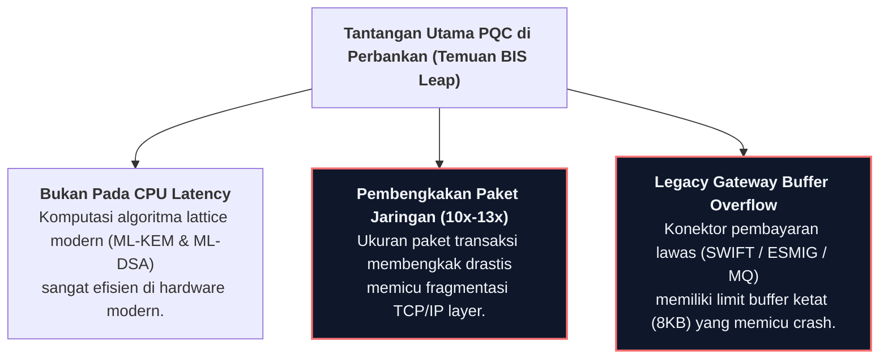

# Studi Kasus: BIS Innovation Hub — Project Leap

> **Institusi:** Bank for International Settlements (BIS), Banque de France, dan Deutsche Bundesbank  
> **Sistem Pengujian:** Real-Time Gross Settlement (RTGS / TARGET2 / ESMIG)  
> **Laporan Resmi:** [BIS Project Leap Phase 2 Report: Post-Quantum Cryptography in Payment Systems](https://www.bis.org/publ/othp86.htm)  
> **Navigasi:** [← Modul 5: Mitigasi Performa & Hardware](../modules/05-performance-hardware-mitigation.md) | [🏠 Beranda](../../README.md) | [Jadwal Portofolio 7 Hari →](../7-day-portfolio-plan.md)

---

## 1. Latar Belakang Eksperimen

Project Leap adalah inisiatif bersama antara BIS Innovation Hub Eurosystem Centre bersama bank sentral Prancis (Banque de France) dan bank sentral Jerman (Deutsche Bundesbank). Tujuannya adalah menguji secara empiris kelayakan migrasi Post-Quantum Cryptography (PQC) pada jaringan infrastruktur pembayaran antar-bank berisiko tinggi (*wholesale RTGS*).

Jaringan pembayaran wholesale memproses triliunan Euro setiap hari. Kerentanan terhadap serangan *Harvest Now, Decrypt Later* (HNDL) pada jaringan ini merupakan ancaman stabilitas keuangan sistemik.

---

## 2. Temuan Kunci & Rekomendasi Arsitektural

### 1. Komputasi CPU Bukan Masalah Utama
Pengujian menunjukkan bahwa waktu eksekusi penandatanganan dan verifikasi ML-DSA serta ML-KEM pada CPU enterprise modern hanya membutuhkan beberapa milidetik, tidak menyebabkan bottleneck komputasi yang signifikan.

### 2. Hambatan Kritis: Pembengkakan Ukuran Paket (Payload Swelling)
Hambatan terbesar muncul dari pembengkakan ukuran kriptografi:
* Ukuran tanda tangan dan sertifikat PQC melonjak hingga **10–13 kali lipat** dibandingkan RSA-2048.
* Lonjakan ini melampaui batas MTU Ethernet standar (1500 bytes) dan memicu pemecahan paket (*IP packet fragmentation*).

### 3. Risiko Buffer Overflow pada Konektor Pembayaran Warisan
Sistem konektor pembayaran warisan (seperti *Eurosystem Single Market Infrastructure Gateway* / ESMIG, antarmuka SWIFT, dan antrian MQ) dikonfigurasikan dengan alokasi buffer pesan yang terbatas (4–8 KB). Pengiriman payload PQC secara mentah tanpa tuning memicu *buffer overflow* atau kegagalan koneksi (*connection reset*).

---

## 3. Pelajaran Berharga bagi Arsitektur SNAP BI & Switching Nasional

Berdasarkan temuan Project Leap, implementasi standar SNAP BI masa depan (2027–2030) dan jaringan switching pembayaran nasional (seperti BI-FAST atau RTOL) wajib mengadopsi langkah mitigasi berikut:

1. **Crypto-Agility:** Rancang arsitektur kode dengan *Strategy Pattern* agar sistem perbankan dapat berpindah algoritma tanpa merombak logika bisnis.
2. **Buffer Capacity Expansion:** Perbesar buffer API Gateway dan application server minimal ke **32 KB**.
3. **Optimasi Protokol Transport:** Adopsi protokol modern seperti HTTP/2 (HPACK) atau gRPC Protobuf untuk menekan overhead header dan Base64 encoding.

---

> [← Kembali ke Modul 5](../modules/05-performance-hardware-mitigation.md) | [Lanjut ke Jadwal Portofolio 7 Hari →](../7-day-portfolio-plan.md)
