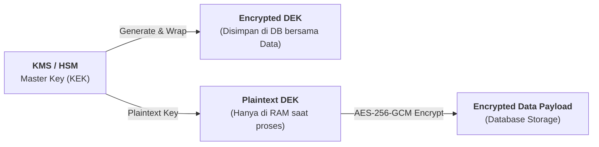

# Modul 1: Kriptografi Data & Inventarisasi Kode

> **Timeline:** *Now — Next 12 Months*  
> **Tujuan:** Mengetahui posisi kerentanan kriptografi di seluruh repositori (*Cryptographic Visibility*) dan mengamankan *data at rest* dari serangan **Store Now, Decrypt Later (SNDL)**.  
> **Navigasi:** [🏠 Beranda](../../README.md) | [Modul Berikutnya: Transport Layer Tahan Kuantum →](./02-quantum-transport-tls.md)

---

## 1. Standar Resmi & Framework Kepatuhan

### NIST SP 1800-38 (Volume A, B, C): *Migration to Post-Quantum Cryptography*
* **Penerbit:** NIST National Cybersecurity Center of Excellence (NCCoE).
* **Fokus Arsitektur:** Volume B memberikan cetak biru arsitektur enterprise untuk *Cryptographic Discovery*, otomatisasi audit dependensi, dan integrasi CBOM ke siklus CI/CD.
* **Link Proyek:** [NIST NCCoE SP 1800-38 Project](https://www.nist.gov/programs-projects/migration-post-quantum-cryptography)
* **Dokumen Lokal di Repositori:**
  * [NIST SP 1800-38A (Executive Summary)](../../references/pqc-migration-nist-sp-1800-38a-preliminary-draft.pdf)
  * [NIST SP 1800-38B (Approach, Architecture, and Security Characteristics)](../../references/pqc-migration-nist-sp-1800-38b-preliminary-draft.pdf)
  * [NIST SP 1800-38C (How-To Guides)](../../references/pqc-migration-nist-sp-1800-38c-preliminary-draft.pdf)

### Spesifikasi CycloneDX v1.6 (Cryptographic Assets / CBOM)
* **Fokus:** Skema standar industri untuk mendokumentasikan aset kriptografi: algoritma, panjang kunci, mode operasi cipher, fungsi padding, level keamanan (NIST Category 1–5), dan sertifikat digital.
* **Spesifikasi:** [CycloneDX 1.6 Cryptographic Properties Specification](https://cyclonedx.org/docs/1.6/)

### PCI DSS v4.0 Requirement 12.3.3 (Mandat Inventaris Kriptografi)
* **Fokus:** Standar wajib kepatuhan industri kartu pembayaran dan perbankan untuk mendokumentasikan siklus hidup seluruh cipher suites dan algoritma.

---

## 2. Tooling Hands-On & Repositori Open-Source

### OWASP `cdxgen` (CLI Generator CBOM)
Tool otomatis untuk memindai proyek Java (Maven/Gradle), Go, Node.js, atau Python guna menghasilkan file CBOM CycloneDX v1.6.
* **Repositori:** [GitHub: CycloneDX/cdxgen](https://github.com/CycloneDX/cdxgen)
* **Perintah Eksekusi:**
  ```bash
  # Instalasi CLI
  npm install -g @cdxgen/cdxgen

  # Pindai project Java / Go dan hasilkan spesifikasi CBOM
  cdxgen -t java --include-crypto --spec-version 1.6 -o cbom.json .
  ```

### Linux Foundation PQCA - CBOMkit (`cbomkit-hyperion` & `cbomkit-theia`)
Tool analisis statis kode untuk mengekstrak jejak algoritma kriptografi langsung dari pustaka pihak ketiga.
* **Repositori:** [GitHub: PQCA / cbomkit](https://github.com/PQCA)

### Semgrep Registry - Custom Cryptography Audit Rules
Kumpulan aturan static analysis untuk mendeteksi instansiasi algoritma legacy seperti `MD5`, `SHA-1`, `DES`, `3DES`, atau `RSA` dengan panjang kunci `< 2048`.
* **Rules Registry:** [Semgrep Registry Cryptography Rules](https://semgrep.dev/explore)

---

## 3. Buku & Arsitektur Enkripsi Simetris (Data at Rest)

### Buku: *Real-World Cryptography* oleh David Wong (Manning Publications)
* **Wajib Baca:** Bab 4 (*Authenticated Encryption / AES-GCM*) dan Bab 12 (*Post-Quantum Cryptography*).
* **Konsep Matematis:** Buku ini menjelaskan mengapa **AES-256 tahan terhadap Algoritma Grover** (keamanan efektif turun menjadi 128-bit, yang secara matematis dan komputasi masih mustahil di-brute force).

### AWS KMS Cryptographic Details Whitepaper
* **Konsep Arsitektur:** Penjelasan teknis mengenai pola arsitektur **Envelope Encryption** (memisahkan *Data Encryption Key* / DEK dari *Key Encryption Key* / KEK) untuk membatasi risiko kebocoran master key.
* **Dokumentasi:** [AWS KMS Envelope Encryption Concepts](https://docs.aws.amazon.com/kms/latest/developerguide/concepts.html#enveloping)



### HashiCorp Vault - Transit Secrets Engine
* **Konsep:** Implementasi *Cryptography-as-a-Service* (CaaS) untuk rotasi DEK terpusat dan klasifikasi data perbankan berdasarkan *shelf-life* (masa retensi kerahasiaan).
* **Tutorial:** [HashiCorp Vault Transit Engine Tutorial](https://developer.hashicorp.com/vault/docs/secrets/transit)

---

> [← Kembali ke Beranda](../../README.md) | [Lanjut ke Modul 2: Quantum Transport Layer →](./02-quantum-transport-tls.md)
