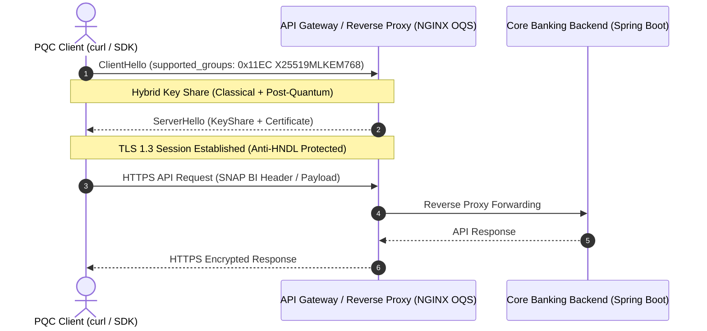

# Modul 2: Transport Layer Tahan Kuantum

> **Timeline:** *Now — Next 12 Months*  
> **Tujuan:** Melindungi trafik jaringan API Gateway / Reverse Proxy dari intersepsi data jaringan dan serangan **Harvest Now, Decrypt Later (HNDL)**.  
> **Navigasi:** [← Modul 1: Kriptografi Data & Inventarisasi Kode](./01-data-and-code-inventory.md) | [🏠 Beranda](../../README.md) | [Modul 3: Algoritma Asimetris PQC di SNAP BI →](./03-application-asymmetric-pqc-snap-bi.md)

---

## 1. Standar & Spesifikasi Protokol Resmi

### RFC 10024: *Post-Quantum Traditional (PQ/T) Hybrid Key Agreement in TLS 1.3*
* **Status:** Standar resmi IETF (*Standards Track*).
* **Konsep Inti:** Menggabungkan kurva eliptik klasik (seperti `X25519` atau `P-256`) dengan mekanisme enkapsulasi kunci post-quantum (**ML-KEM-768**) secara atomik di dalam satu *handshake* TLS 1.3. Jika salah satu algoritma dipecahkan, komunikasi tetap aman selama algoritma pasangannya bertahan.
* **Codepoints Resmi IANA:**
  * `0x11EC` → **`X25519MLKEM768`** *(Rekomendasi standar industri untuk external public endpoint)*
  * `0x11ED` → **`SecP256r1MLKEM768`**
  * `0x11EE` → **`SecP384r1MLKEM1024`**
* **Dokumentasi IETF:** [IETF RFC 10024](https://datatracker.ietf.org/doc/rfc10024/)



---

## 2. Repositori Praktik & Lab Sandbox

### Open Quantum Safe (OQS) Project (Linux Foundation)
Proyek open-source terkemuka yang menyediakan pustaka inti bahasa C (`liboqs`) serta provider OpenSSL 3.2+ (`oqs-provider`).
* **Repositori:** [open-quantum-safe/liboqs](https://github.com/open-quantum-safe/liboqs) & [oqs-provider](https://github.com/open-quantum-safe/oqs-provider)

#### Lab Praktik Cepat dengan Docker
File skrip otomatis tersedia di repositori ini: [`examples/docker/run-oqs-sandbox.sh`](../../examples/docker/run-oqs-sandbox.sh).

```bash
# 1. Jalankan NGINX Reverse Proxy dengan kemampuan PQC TLS 1.3
docker run --name oqs-nginx -p 4433:4433 -d openquantumsafe/nginx

# 2. Uji coba Client Handshake menggunakan curl PQC
docker run --rm -it openquantumsafe/curl curl -k -v --tlsv1.3 \
  --curves x25519_mlkem768 https://host.docker.internal:4433
```

### Cloudflare Post-Quantum Cryptography Engineering Blog
Dokumentasi dan data telemetri produksi terbesar di dunia mengenai performa dan implementasi `X25519MLKEM768` di edge server global.
* **Artikel:** [Cloudflare Post-Quantum Blog Series](https://blog.cloudflare.com/tag/post-quantum/)

### Validasi Paket dengan Wireshark 4.4+
Gunakan Wireshark versi terbaru untuk menginspeksi paket `ClientHello` TLS 1.3:
1. Filter: `tls.handshake.type == 1`
2. Buka ekstensi: `supported_groups` dan `key_share`
3. Pastikan codepoint yang dinegosiasikan adalah `0x11EC` (`x25519_mlkem768`).

---

> [← Modul 1: Kriptografi Data & Inventarisasi Kode](./01-data-and-code-inventory.md) | [Lanjut ke Modul 3: Algoritma Asimetris PQC di SNAP BI →](./03-application-asymmetric-pqc-snap-bi.md)
