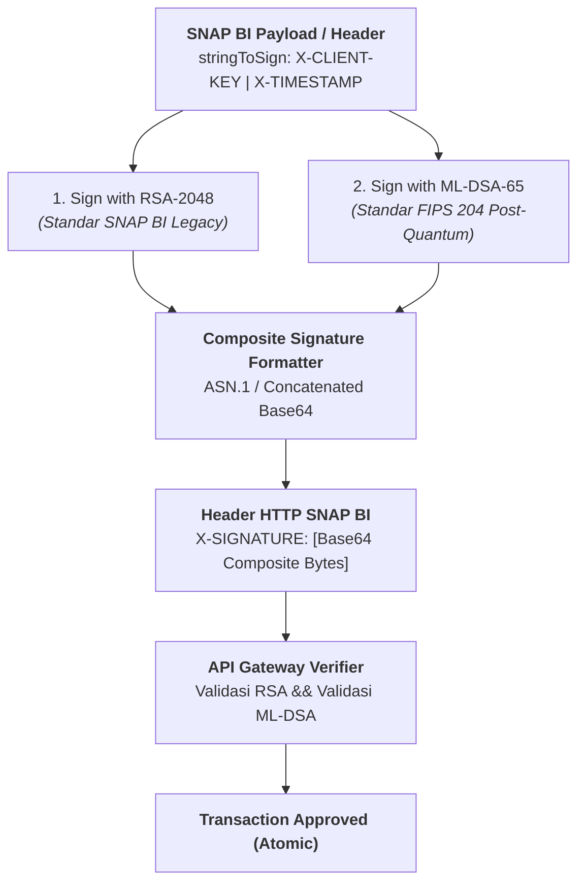

# Modul 3: Algoritma Asimetris PQC di Level Aplikasi (SNAP BI)

> **Timeline:** *2027 — 2028*  
> **Tujuan:** Menguasai algoritma pengganti `RSA-2048` pada header `X-SIGNATURE` SNAP BI dan mekanisme pertukaran kunci antar-*microservice*.  
> **Navigasi:** [← Modul 2: Quantum Transport Layer](./02-quantum-transport-tls.md) | [🏠 Beranda](../../README.md) | [Modul 4: Manajemen Identitas Token & AI Agent →](./04-identity-ai-agent-governance.md)

---

## 1. Standar Resmi NIST FIPS (Dirilis 13 Agustus 2024)

Pada 13 Agustus 2024, NIST meresmikan tiga standar kriptografi pasca-kuantum utama dunia:

| Standar FIPS | Nama Algoritma Asli | Fungsi Utama | Karakteristik Kunci |
| :--- | :--- | :--- | :--- |
| **FIPS 203** | **ML-KEM** *(turunan CRYSTALS-Kyber)* | Key-Encapsulation Mechanism (KEM) | Membungkus & mempertukarkan *shared secret* simetris (AES-256) antar service. Varian: ML-KEM-512, 768, 1024. |
| **FIPS 204** | **ML-DSA** *(turunan CRYSTALS-Dilithium)* | Digital Signature Standard | Tanda tangan digital utama pengganti RSA & ECDSA pada level aplikasi API. Varian: ML-DSA-44, 65, 87. |
| **FIPS 205** | **SLH-DSA** *(turunan SPHINCS+)* | Stateless Hash-Based Signature | Tanda tangan berbasis fungsi hash murni (bebas asumsi matematika lattice) sebagai jaring pengaman sekunder. |

* **Publikasi Resmi NIST:**
  * [NIST FIPS 203 Final Publication](https://csrc.nist.gov/pubs/fips/203/final)
  * [NIST FIPS 204 Final Publication](https://csrc.nist.gov/pubs/fips/204/final)
  * [NIST FIPS 205 Final Publication](https://csrc.nist.gov/pubs/fips/205/final)

---

## 2. Ekosistem Java & Spring Boot

### Bouncy Castle Provider (`bcprov-jdk18on` v1.80+)
* Mendukung penuh FIPS 204 (`ML-DSA-44`, `ML-DSA-65`, `ML-DSA-87`) dan FIPS 203 (`ML-KEM-512`, `ML-KEM-768`, `ML-KEM-1024`).
* Repositori: [GitHub: bcgit/bc-java](https://github.com/bcgit/bc-java)

### Roadmap JDK Resmi (JEP)
* **JEP 452 (Java 21 LTS):** Abstraksi framework API `javax.crypto.KEM`.
* **JEP 496 (Java 24+):** Dukungan native ML-KEM di JDK.
* **JEP 497 (Java 24+):** Dukungan native ML-DSA di JDK.
> *Catatan Arsitektur:* Pada Java 21 LTS, developer wajib mendaftarkan provider Bouncy Castle v1.80+ secara eksplisit via `Security.addProvider(new BouncyCastleProvider())`.

### Contoh Implementasi: Signing Header SNAP BI dengan ML-DSA-65
*Source code lengkap siap compile tersedia di repositori ini:* [`examples/java/SnapPqcSigner.java`](../../examples/java/SnapPqcSigner.java).

```java
package com.bank.snap.crypto;

import org.bouncycastle.jce.provider.BouncyCastleProvider;
import java.nio.charset.StandardCharsets;
import java.security.*;
import java.util.Base64;

public class SnapPqcSigner {
    static {
        if (Security.getProvider("BC") == null) {
            Security.addProvider(new BouncyCastleProvider());
        }
    }

    public static void main(String[] args) throws Exception {
        // 1. Generate KeyPair ML-DSA-65 (NIST Security Category 3)
        KeyPairGenerator kpg = KeyPairGenerator.getInstance("ML-DSA-65", "BC");
        KeyPair keyPair = kpg.generateKeyPair();

        // 2. Format stringToSign sesuai Standar Teknis SNAP BI B2B Token
        String clientKey = "MERCHANT-CORP-ID-00129";
        String xTimestamp = "2026-10-29T14:30:00+07:00";
        String stringToSign = clientKey + "|" + xTimestamp;

        // 3. Signing menggunakan ML-DSA-65 (FIPS 204)
        Signature signer = Signature.getInstance("ML-DSA-65", "BC");
        signer.initSign(keyPair.getPrivate());
        signer.update(stringToSign.getBytes(StandardCharsets.UTF_8));
        byte[] signatureBytes = signer.sign();

        String xSignature = Base64.getEncoder().encodeToString(signatureBytes);
        System.out.println("ML-DSA-65 Raw Signature Size: " + signatureBytes.length + " bytes"); // 3.309 bytes
        System.out.println("X-SIGNATURE Base64 Length: " + xSignature.length() + " chars");       // ~4.412 chars

        // 4. Verifikasi Signature di sisi API Gateway Bank
        Signature verifier = Signature.getInstance("ML-DSA-65", "BC");
        verifier.initVerify(keyPair.getPublic());
        verifier.update(stringToSign.getBytes(StandardCharsets.UTF_8));
        boolean isValid = verifier.verify(signatureBytes);

        System.out.println("SNAP BI Signature Verified: " + isValid);
    }
}
```

---

## 3. Ekosistem Go (Golang)

### Standard Library Go 1.24+: `crypto/mlkem`
Implementasi native FIPS 203 ML-KEM-768 dan ML-KEM-1024 tanpa dependency pihak ketiga.
* **Dokumentasi Resmi:** [Go Documentation: pkg.go.dev/crypto/mlkem](https://pkg.go.dev/crypto/mlkem)

### Cloudflare CIRCL (`circl/sign/mldsa`)
Pustaka Go produksi dari Cloudflare untuk implementasi penandatanganan digital FIPS 204 ML-DSA.
* **Repositori:** [GitHub: cloudflare/circl](https://github.com/cloudflare/circl)

---

## 4. Tanda Tangan Komposit / Hybrid & Standar SNAP BI

### IETF Draft: `draft-ietf-lamps-pq-composite-sigs`
* **Judul:** *Composite Module-Lattice-Based Digital Signature Algorithm for use in X.509 PKI*.
* **Arsitektur Dual-Signing:** Menggabungkan signature klasik (`RSA-2048` atau `ECDSA`) dengan `ML-DSA` secara atomik dalam satu envelope. Verifikasi transaksi dinyatakan berhasil **jika dan hanya jika kedua tanda tangan valid**.
* **Spesifikasi:** [IETF draft-ietf-lamps-pq-composite-sigs](https://datatracker.ietf.org/doc/draft-ietf-lamps-pq-composite-sigs/)



### Pedoman Resmi SNAP BI (Bank Indonesia & ASPI)
* Dokumentasi resmi spesifikasi teknis SNAP B2B Token Asymmetric Signature & Transactional Symmetric Signature.
* [Portal Standar Nasional Open API Pembayaran (SNAP) BI](https://www.bi.go.id/id/fungsi-utama/sistem-pembayaran/standar/snap/default.aspx)

---

> [← Modul 2: Quantum Transport Layer](./02-quantum-transport-tls.md) | [Lanjut ke Modul 4: Manajemen Identitas Token & AI Agent →](./04-identity-ai-agent-governance.md)
