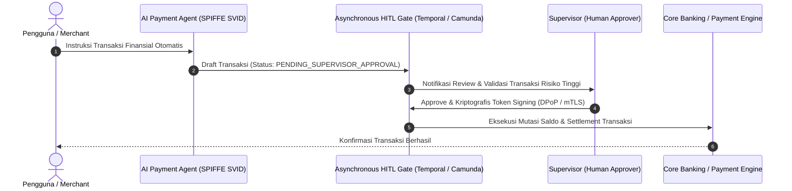

# Modul 4: Manajemen Identitas Modern: Token & AI Agent

> **Timeline:** *Now s/d 2028*  
> **Tujuan:** Mencegah pencurian token API perbankan via mekanisme *Proof-of-Possession* dan membangun tata kelola identitas kriptografis otonom untuk AI Agent.  
> **Navigasi:** [← Modul 3: Algoritma Asimetris PQC di SNAP BI](./03-application-asymmetric-pqc-snap-bi.md) | [🏠 Beranda](../../README.md) | [Modul 5: Mitigasi Performa & Integrasi Hardware →](./05-performance-hardware-mitigation.md)

---

## 1. Device-Bound Tokens (Anti-Theft API Tokens)

Dalam arsitektur API perbankan modern, *Bearer Token* konvensional memiliki kelemahan fatal: jika token bocor melalui log atau inspeksi trafik, siapa pun dapat menggunakannya. Mekanisme *Proof-of-Possession* mengikat token ke kunci kriptografi privat milik pemanggil.

### RFC 9449: *OAuth 2.0 Demonstrating Proof-of-Possession (DPoP)*
* **Konsep:** Klien membuktikan kepemilikan private key dengan menyertakan header `DPoP` (JWT bertanda tangan secara lokal) pada setiap panggilan API ke endpoint otorisasi maupun resource server.
* **Token Binding:** Token akses diikat secara kriptografis ke sidik jari kunci publik klien (`cnf.jkt`). Jika token dicuri, penyerang tidak dapat menggunakannya tanpa private key lokal yang cocok.
* **Spesifikasi:** [IETF RFC 9449](https://datatracker.ietf.org/doc/html/rfc9449)

### RFC 8705: *OAuth 2.0 Mutual-TLS Client Authentication and Certificate-Bound Access Tokens*
* **Konsep:** Token diikat langsung ke sertifikat X.509 pada sesi mTLS klien (*sender-constrained tokens*).
* **Spesifikasi:** [IETF RFC 8705](https://datatracker.ietf.org/doc/html/rfc8705)

### Spring Security OAuth 2.0 DPoP Reference
* Dukungan DPoP otomatis tersedia pada Spring Security 6.5–7.0.
* Konfigurasi DSL eksplisit `.dPoP(Customizer.withDefaults())` tersedia di Spring Security 7.1+.
* **Dokumentasi Resmi:** [Spring Security DPoP Documentation](https://docs.spring.io/spring-security/reference/servlet/oauth2/resource-server/dpop.html)

---

## 2. Tata Kelola Identitas AI Agent (Non-Human Identity & Delegation)

Ketika AI Agent mandiri mengeksekusi aksi finansial di dalam sistem perbankan, sistem membutuhkan verifikasi kriptografis non-manusia yang dapat diaudit secara hukum.

### CNCF SPIFFE / SPIRE
* **Konsep:** Standar industri untuk memberikan identitas kriptografis (*SPIFFE ID* & *SVID*) berbasis X.509 atau JWT kepada container, microservice, atau AI Agent runtime.
* **Prinsip:** Kredensial berumur sangat pendek (*short-lived*), dirotasi otomatis tanpa intervensi manual, dan diverifikasi berbasis bukti lingkungan runtime (*attestation*).
* **Dokumentasi:** [SPIFFE / SPIRE Official Concepts](https://spiffe.io/docs/latest/spiffe-about/spiffe-concepts/)

### IETF WIMSE (Workload Identity in Multi-System Environments)
* **Konsep:** Standarisasi bridging antara SPIFFE workload identity dengan OAuth 2.0 token exchange untuk sistem terdistribusi multi-cloud dan lintas institusi perbankan.
* **Dokumentasi:** [IETF WIMSE Working Group](https://datatracker.ietf.org/wg/wimse/about/)

### RFC 8693: *OAuth 2.0 Token Exchange*
* **Actor Claim (`act`):** Mendokumentasikan jejak audit rantai delegasi identitas:
  $$\text{User} \rightarrow \text{Orchestrator Agent} \rightarrow \text{Payment Execution Agent}$$
* **Spesifikasi:** [IETF RFC 8693](https://datatracker.ietf.org/doc/html/rfc8693)

---

## 3. Human-in-the-Loop (HITL) Asynchronous Approval Gates

Untuk transaksi bernilai tinggi atau anomali profil risiko, AI Agent dilarang melakukan settlement langsung.

* **Framework Orkestrasi:** **Temporal.io** atau **Camunda 8 (BPMN User Tasks)**.
* **Alur Eksekusi:**
  1. Agen AI menyusun draf instruksi transaksi finansial.
  2. Transaksi masuk ke status `PENDING_SUPERVISOR_APPROVAL` dalam durable execution workflow.
  3. Notifikasi dikirimkan ke supervisor manusia beserta bukti identitas AI Agent.
  4. Supervisor memvalidasi dan menandatangani kriptografis token persetujuan (DPoP / mTLS).
  5. Workflow melanjutkan proses mutasi saldo dan settlement ke core banking.

---

> [← Modul 3: Algoritma Asimetris PQC di SNAP BI](./03-application-asymmetric-pqc-snap-bi.md) | [Lanjut ke Modul 5: Mitigasi Performa & Integrasi Hardware →](./05-performance-hardware-mitigation.md)
