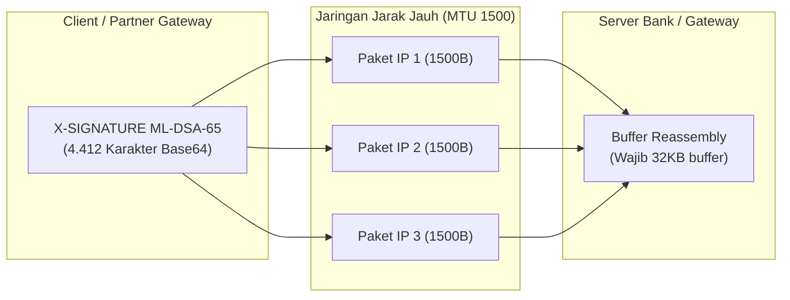

# Modul 5: Mitigasi Performa & Integrasi Hardware

> **Target:** *Level Arsitek Sistem Pembayaran*  
> **Tujuan:** Mengamankan private key ke modul HSM dan merekayasa infrastruktur jaringan agar tidak mengalami bottleneck atau kegagalan akibat pembengkakan payload PQC.  
> **Navigasi:** [← Modul 4: Manajemen Identitas Token & AI Agent](./04-identity-ai-agent-governance.md) | [🏠 Beranda](../../README.md) | [Studi Kasus: BIS Project Leap →](../case-studies/bis-project-leap.md)

---

## 1. Hardware Security Module (HSM) & PKCS#11 PQC

Dalam perbankan Tier-1, private key penandatanganan transaksi tidak boleh berada di memori server aplikasi biasa, melainkan wajib dilindungi di dalam Hardware Security Module (HSM) bertaraf FIPS 140-3 Level 3/4.

### Spesifikasi OASIS PKCS#11 v3.2 (PQC Extension Mechanisms)
* Standar industri untuk antarmuka token hardware kriptografi.
* Menetapkan mekanisme operasional hardware untuk:
  * `CKM_ML_DSA`
  * `CKM_ML_KEM`
  * `CKM_SLH_DSA`
* **Dokumentasi Komite OASIS:** [OASIS PKCS#11 Committee Specifications](https://www.oasis-open.org/committees/pkcs11/)

### wolfPKCS11 & SoftHSM Open-Source Integrations
* Pustaka ringan untuk simulasi token kriptografi PKCS#11 yang telah mendukung algoritma post-quantum.
* [GitHub: wolfSSL/wolfPKCS11](https://github.com/wolfSSL/wolfPKCS11)
* [Oracle Java PKCS#11 Reference Guide](https://docs.oracle.com/en/java/javase/21/security/pkcs11-reference-guide1.html)

---

## 2. Pembengkakan Payload & Fragmentasi Jaringan (MTU Mitigation)

Tantangan terbesar transisi PQC di sistem pembayaran bukan pada latensi CPU, melainkan **ukuran kunci publik dan tanda tangan yang melonjak hingga 13x lipat**.

### Perbandingan Ukuran Kriptografis (Matematika Payload)

| Algoritma | Public Key Size | Signature Size | Ukuran Base64 di Header HTTP | Dampak Jaringan |
| :--- | :---: | :---: | :---: | :--- |
| **RSA-2048** *(Legacy)* | 256 bytes | 256 bytes | $\approx$ **344 karakter** | Muat dalam 1 paket Ethernet IP tunggal. |
| **ML-DSA-65** *(FIPS 204)* | 1.952 bytes | 3.309 bytes | $\approx$ **4.412 karakter** | Terpecah menjadi minimal **3 paket IP**. |
| **Composite (RSA + ML-DSA)** | >2.208 bytes | >3.565 bytes | $\approx$ **4.760 karakter** | Terpecah menjadi **4 paket IP**. |

### Masalah Fragmentasi TCP/IP Layer
* Batas **Maximum Transmission Unit (MTU)** Ethernet standar adalah **1500 bytes**.
* Header HTTP yang membawa `X-SIGNATURE` ML-DSA-65 berukuran ~4,4 KB dipastikan mengalami fragmentasi IP.
* Jika salah satu fragmen paket hilang (*packet loss*) pada koneksi jaringan switching, seluruh payload harus ditransmisi ulang, memicu lonjakan latensi $p99$ atau kegagalan transaksi.



---

## 3. Tuning Buffer Web Server & API Gateway

Default konfigurasi web server modern (Tomcat, Netty, NGINX) biasanya dirancang untuk header HTTP kecil (4–8 KB). Ketika header SNAP BI membawa sertifikat X.509, token DPoP, header tracing, dan signature PQC, server akan langsung menolak request dengan status **HTTP 431 Request Header Fields Too Large**.

### Spring Boot (Tomcat / Netty)
Konfigurasikan batas ukuran header HTTP maksimal hingga 32 KB:

```yaml
# application.yml
server:
  max-http-request-header-size: 32KB
```

### NGINX API Gateway / Reverse Proxy
File template siap pakai tersedia di repositori: [`examples/nginx/nginx-pqc-buffer.conf`](../../examples/nginx/nginx-pqc-buffer.conf).

```nginx
# nginx.conf
client_header_buffer_size 4k;
large_client_header_buffers 4 32k;
```

---

## 4. Solusi Lanjutan: HTTP/2 HPACK & Migrasi ke gRPC

1. **HTTP/2 (RFC 7541 HPACK) & HTTP/3 (QPACK):**
   * Mengompresi overhead header HTTP berulang antar-request pembayaran finansial berkecepatan tinggi.
2. **gRPC / Protocol Buffers (Biner Payload):**
   * Format teks Base64 menambah penalti overhead sebesar **33%**.
   * Memindahkan signature dan payload ke field biner protobuf (`bytes`) meniadakan konversi Base64 dan memangkas ukuran transmisi jaringan hingga puluhan persen.

---

> [← Modul 4: Manajemen Identitas Token & AI Agent](./04-identity-ai-agent-governance.md) | [Lanjut ke Studi Kasus: BIS Project Leap →](../case-studies/bis-project-leap.md)
