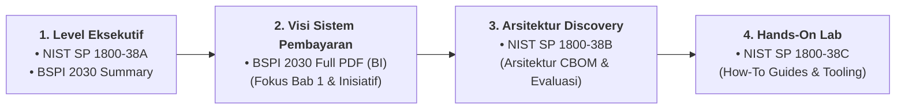

# Peta Dokumen & Panduan Membaca Referensi Resmi PQC & BSPI 2030

Direktori ini menyimpan dokumen resmi kebijakan perbankan nasional (**Bank Indonesia**) dan standar arsitektur migrasi kriptografi pasca-kuantum internasional (**NIST NCCoE**).

---

## 📚 Urutan Membaca yang Direkomendasikan (Reading Path)

Agar pemahaman arsitektur terbentuk secara komprehensif tanpa terjebak detail matematis yang terlalu padat, ikuti urutan membaca 4 tahap berikut:

---

## 📑 Daftar Berkas & Penjelasan Detail

### 1. Standar Regulasi & Kebijakan Nasional (Bank Indonesia)

| Dokumen | Format & Ukuran | Fokus & Relevansi Arsitektural |
| :--- | :---: | :--- |
| [`bspi-2030-executive-summary.md`](./bspi-2030-executive-summary.md) | Markdown (~5 KB) | **Ringkasan Intisari:** Rangkuman 5 Visi BSPI 2030, mandat UU P2SK, dan korelasinya terhadap kebutuhan keamanan backend (SNAP BI, ketahanan switching, AI governance). |
| [`Blueprint-Sistem-Pembayaran-Indonesia-2030_2.pdf`](./Blueprint-Sistem-Pembayaran-Indonesia-2030_2.pdf) | PDF Resmi (~26 MB) | **Dokumen Sumber:** Cetak biru resmi Bank Indonesia (52 halaman). Wajib dibaca pada Bab 1 (*Lingkungan Strategis*) dan arahan penguatan infrastruktur berdaya tahan. |

### 2. Standar Migrasi Kriptografi Pasca-Kuantum (NIST SP 1800-38 Suite)

Proyek kolaboratif **NIST National Cybersecurity Center of Excellence (NCCoE)** bersama industri perbankan dan teknologi global:

| Volume | Berkas PDF | Target Pembaca & Cakupan Materi |
| :---: | :--- | :--- |
| **Volume A** | [`pqc-migration-nist-sp-1800-38a-preliminary-draft.pdf`](./pqc-migration-nist-sp-1800-38a-preliminary-draft.pdf) *(~414 KB)* | **Executive Summary:** Menjelaskan risiko *Store Now, Decrypt Later* (SNDL) dan *Harvest Now, Decrypt Later* (HNDL), urgensi audit inventarisasi aset kriptografi, dan langkah awal transisi organisasi. |
| **Volume B** | [`pqc-migration-nist-sp-1800-38b-preliminary-draft.pdf`](./pqc-migration-nist-sp-1800-38b-preliminary-draft.pdf) *(~1.7 MB)* | **Approach, Architecture, and Security Characteristics:** Cetak biru arsitektur enterprise teknis. Menguraikan desain otomatisasi *Cryptographic Discovery*, pembuatan *Cryptography Bill of Materials* (CBOM), dependensi pustaka pihak ketiga, dan integrasi CI/CD pipeline. *(Referensi utama Modul 1)*. |
| **Volume C** | [`pqc-migration-nist-sp-1800-38c-preliminary-draft.pdf`](./pqc-migration-nist-sp-1800-38c-preliminary-draft.pdf) *(~1.6 MB)* | **How-To Guides:** Petunjuk teknis implementasi langkah demi langkah (*hands-on installation*) untuk pengujian laboratorium, konfigurasi tool scanner, dan integrasi modul. |

---

> [← Kembali ke Beranda](../../README.md)
