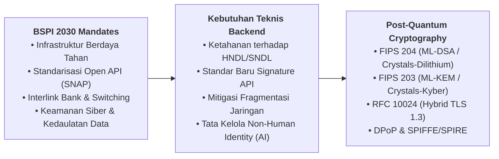

# Ringkasan Eksekutif: Blueprint Sistem Pembayaran Indonesia 2030 (BSPI 2030)

> **Dokumen Sumber:** Bank Indonesia — *Blueprint Sistem Pembayaran Indonesia 2030: Mengakselerasi Ekonomi Digital Nasional untuk Generasi Mendatang*  
> **File Referensi Asli:** [`Blueprint-Sistem-Pembayaran-Indonesia-2030_2.pdf`](./Blueprint-Sistem-Pembayaran-Indonesia-2030_2.pdf) (26 MB)

---

## 1. Latar Belakang & Visi Strategis

Blueprint Sistem Pembayaran Indonesia 2030 (BSPI 2030) merupakan kelanjutan langsung dan eskalasi dari BSPI 2025. Diluncurkan oleh Bank Indonesia sebagai mandat dari **Undang-Undang No. 4 Tahun 2023 tentang Pengembangan dan Penguatan Sektor Keuangan (UU P2SK)**.

Tujuan utama BSPI 2030 adalah mewujudkan **Sistem Pembayaran Indonesia yang berdaya tahan (resilient) dalam struktur yang konsolidatif**, guna mengintegrasikan Ekonomi dan Keuangan Digital (EKD) secara *end-to-end*.

### 3 Sasaran Kebijakan Utama:
1. **Transaksi dan Velositas:** Transaksi sistem pembayaran ritel dan wholesale yang cepat, mudah, murah, aman, dan andal.
2. **Struktur:** Struktur industri jasa sistem pembayaran yang sehat, kompetitif, dan inovatif dengan praktik pasar yang efisien dan wajar (interlink bank & fintech).
3. **Infrastruktur:** Infrastruktur yang stabil, modern, berstandar internasional, serta memenuhi aspek **3i (Interkoneksi, Interoperabilitas, dan Integrasi)** baik pada sistem Bank Indonesia maupun industri.

---

## 2. Lima Visi Sistem Pembayaran Indonesia 2030

| Visi | Fokus & Arahan Strategis |
| :--- | :--- |
| **Visi 1** | Mendukung integrasi ekonomi-keuangan digital nasional guna menjamin fungsi bank sentral dalam peredaran uang, kebijakan moneter, dan stabilitas sistem keuangan, serta mendorong inklusi keuangan. |
| **Visi 2** | Mendukung digitalisasi perbankan sebagai lembaga utama dalam ekonomi keuangan digital melalui *open banking* maupun pemanfaatan teknologi digital dan data. |
| **Visi 3** | Menjamin interlink antara fintech dan perbankan guna menghindari risiko *shadow-banking* melalui regulasi teknologi digital (seperti Open API / SNAP), kerja sama bisnis, dan tata kelola kepemilikan. |
| **Visi 4** | Menjamin keseimbangan antara inovasi dengan *consumer protection*, integritas, dan stabilitas serta persaingan usaha yang sehat melalui KYC, AML-CFT, keterbukaan data, serta penerapan *RegTech* dan *SupTech*. |
| **Visi 5** | Menjamin kepentingan nasional dalam ekonomi-keuangan digital lintas negara melalui kewajiban pemrosesan transaksi domestik di dalam negeri dan resiprokalitas kerja sama internasional. |

---

## 3. Titik Temu Kritis BSPI 2030 dengan Post-Quantum Cryptography (PQC) & Backend Engineering

Meskipun BSPI 2030 dirumuskan pada level kebijakan makro dan regulasi sistem pembayaran nasional, implementasi teknis di industri (PJP, PIP, Bank, Switching) terikat langsung pada tuntutan arsitektur keamanan tingkat tinggi:

1. **Evolusi Standar Nasional Open API Pembayaran (SNAP BI):**
   * Saat ini SNAP BI mewajibkan penandatanganan asimetris payload menggunakan `SHA256withRSA` (RSA-2048).
   * Pada roadmap ketahanan industri 2027–2030, algoritma RSA mandiri akan dipensiunkan untuk transaksi berisiko tinggi dan digantikan oleh profil pasca-kuantum (*Composite Signature* / ML-DSA).
2. **Ketahanan Infrastruktur Switching & Fast Payment (BI-FAST & RTGS):**
   * Mengacu pada eksperimen bank sentral global (*BIS Project Leap*), pembengkakan ukuran signature PQC (dari 256 byte pada RSA menjadi >3.300 byte pada ML-DSA) dapat memicu *MTU packet fragmentation* dan *buffer overflow* pada gateway pembayaran warisan.
   * Backend engineer wajib menyiapkan tuning buffer web server (Tomcat/Netty/NGINX minimal 32 KB) dan arsitektur gRPC/HTTP-2 HPACK.
3. **Kedaulatan & Perlindungan Data Finansial dari Ancaman *Harvest Now, Decrypt Later* (HNDL):**
   * Lalu lintas data transaksi sensitif perbankan yang melewati jaringan publik wajib dienkripsi menggunakan *Hybrid Post-Quantum TLS 1.3* (`X25519MLKEM768`) agar tidak dapat didekripsi di masa depan saat komputer kuantum berskala kriptoanalisis beroperasi.
4. **Tata Kelola Otonomi AI Agent di Sektor Keuangan:**
   * Sejalan dengan penguatan pengawasan dan pelindungan konsumen (Visi 4 BSPI 2030), integrasi AI Agent untuk inisiasi pembayaran wajib menerapkan identitas kriptografis (*SPIFFE/SPIRE*), jejak delegasi (*OAuth Token Exchange*), dan gerbang persetujuan manusia (*Asynchronous Human-in-the-Loop*).

---

## 4. Akses File Dokumen Resmi

File PDF lengkap resmi dari Bank Indonesia tersimpan di direktori repository ini:
* File: [`references/Blueprint-Sistem-Pembayaran-Indonesia-2030_2.pdf`](./Blueprint-Sistem-Pembayaran-Indonesia-2030_2.pdf)
* Ukuran: ~26 MB
* Halaman: 52 Halaman (Full PDF Resmi Bank Indonesia)
